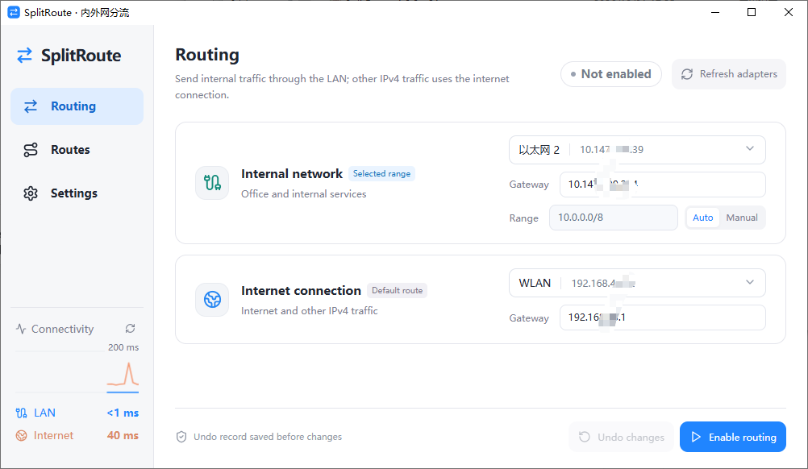
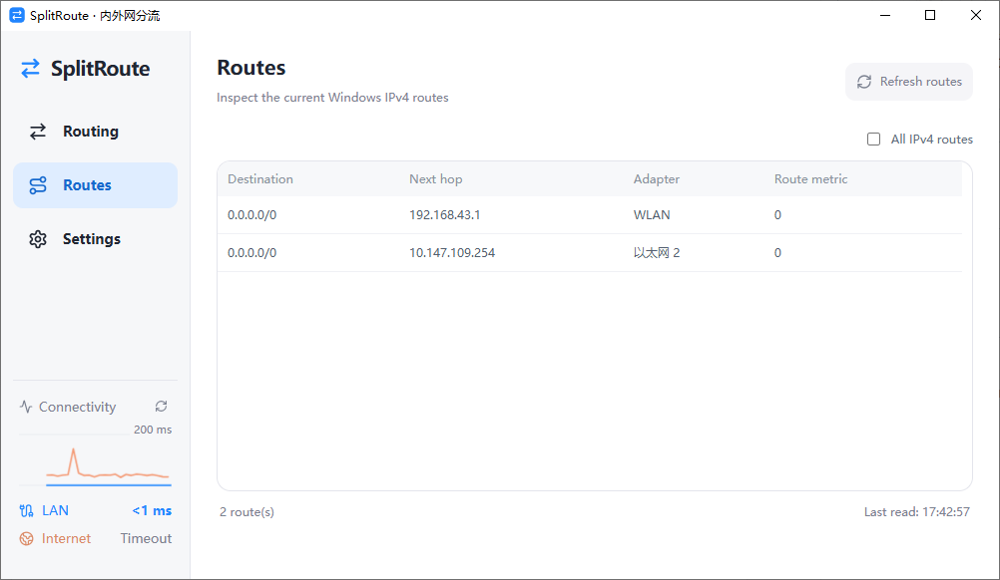
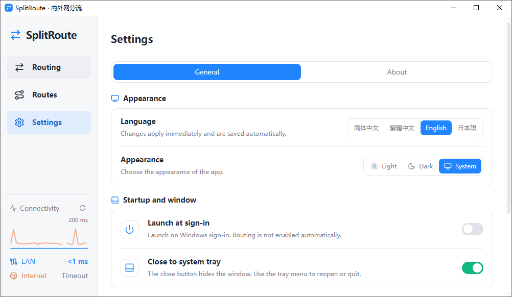
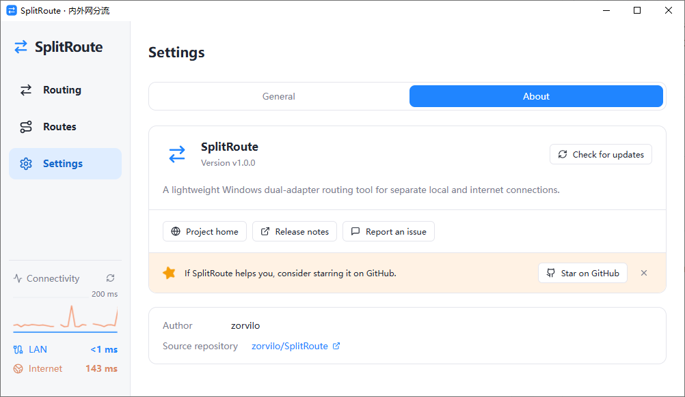

# SplitRoute

A lightweight Windows dual-adapter routing tool for using a private network and the internet side by side.

[简体中文](README.md) | **English**

[Download v1.0.1](https://github.com/zorvilo/SplitRoute/releases/tag/v1.0.1) · [Quick start](#quick-start) · [Network behavior](#network-behavior) · [Report an issue](https://github.com/zorvilo/SplitRoute/issues)



## Use cases

Connect your computer to a private network and the internet at the same time, so you can access internal business systems alongside internet services. Assign either adapter to either role: Ethernet can serve the private network and Wi-Fi the internet, or the other way around.

SplitRoute sends the specified IPv4 subnet through the private-network adapter and uses the internet adapter as the default exit for other IPv4 traffic. Existing more specific routes still take priority.

You need two usable network interfaces and correct gateway settings. SplitRoute does not give internet access to an interface that cannot already reach the internet. It is not a proxy or VPN and does not route by domain or application.

## Features

- **Private-network and internet routing**: choose adapters, gateways and a subnet, then review the summary before applying changes.
- **Automatic subnet suggestions**: fill in a private IPv4 range or enter a subnet manually.
- **Undo this session's changes**: record modifications and check the environment and affected routes before undoing them.
- **Actual route table**: view relevant routes or all IPv4 routes, with the last successful read time.
- **Network-change alerts**: keep an alert visible when related adapters or routes change, then verify recovery. Routes are not repaired automatically.
- **Connectivity checks**: monitor latency through the selected adapters using customizable IPv4 targets.
- **Desktop preferences**: close to tray, optional launch at login, light/dark/system themes, and Simplified Chinese, Traditional Chinese, English and Japanese UI languages.

## Download and requirements

The current version is **1.0.1**. Get the Windows x64 installer or standalone executable from the [download page](https://github.com/zorvilo/SplitRoute/releases/tag/v1.0.1), or run from source using the [development guide](#development-guide).

Future versions will appear in [GitHub Releases](https://github.com/zorvilo/SplitRoute/releases). Do not distribute the development EXE by itself: it depends on a local development server.

Requires Windows 10/11 and Microsoft Edge WebView2 Runtime. The installer is configured to download the runtime if it is missing; an offline browser engine is not bundled. Modifying routes requires administrator permission. Unsigned builds may trigger Windows reputation warnings.

## Quick start

1. **Connect both networks**: select the private-network and internet adapters on the routing page.
2. **Review the configuration**: check both gateways and the destination subnet that should use the private network.
3. **Enable routing**: review the summary and confirm. When running without administrator permission, use the elevation prompt to restart as administrator, then confirm the operation again.
4. **Check the state**: inspect actual routes on the Routes page. Use the undo action when you need to revert this session's recorded changes.

### Automatic subnet rules

| Selected private-network IPv4 | Suggested subnet |
| ----------------------------- | ---------------- |
| `10.x.x.x`                    | `10.0.0.0/8`     |
| `172.16.x.x`–`172.31.x.x`     | `172.16.0.0/12`  |
| `192.168.x.x`                 | `192.168.0.0/16` |

Automatic mode uses the selected adapter's first IPv4 address to identify these ranges. Other addresses require manual input. These are entire private address ranges, not necessarily the actual range used by your organization. Use manual mode if only a narrower subnet needs the private-network exit.

## Screenshots

<details>
<summary>Routes</summary>

The page reads routes when opened and can show relevant routes or all IPv4 routes. Successful reads update the table and timestamp without repeated success notifications.



</details>

<details>
<summary>General settings</summary>

Choose the UI language and light, dark or system theme. Valid settings are saved automatically.

The first time you click the close button, choose whether to hide to the tray or exit. Select **Remember my choice** to use that action next time. Change it any time in **Settings → General**. Launch at login is off by default.



</details>

<details>
<summary>About</summary>

View the version, open the project page, report issues or check for updates manually. Updates are not downloaded or installed automatically; a release-page link is offered when an update is available.



</details>

These screenshots show the English UI. Window titles and adapter names may remain in the system language; some addresses are obscured. Adapter names, gateways and routes belong to the demonstration environment; do not copy them into your own configuration. The General screenshot does not show the Connectivity checks group farther down the page.

## Network behavior

| Question                                                         | Behavior                                                                                                                                                                                                |
| ---------------------------------------------------------------- | ------------------------------------------------------------------------------------------------------------------------------------------------------------------------------------------------------- |
| Does closing the app restore the network?                        | No. Temporary routes stay active after the app exits. To revert them, click **Undo changes** first.                                                                                                     |
| Does routing survive a reboot?                                   | SplitRoute does not write persistent routes. Windows and other network software rebuild routes after reboot. Check again and enable routing if needed. Old undo records are not replayed automatically. |
| How is the state determined after reopening?                     | The app reads actual adapters and routes instead of relying only on a previous enable record.                                                                                                           |
| Does undo reset all network settings?                            | No. It only undoes changes recorded during the current Windows boot. Changes to adapters, IPs, gateways or affected routes may stop undo to avoid overwriting other modifications.                      |
| Are DNS or IPv6 settings changed?                                | No. Only IPv4 routes are handled. IPv6 traffic is outside these routing rules.                                                                                                                          |
| Will the app automatically enable routing after a disconnection? | No. While running, the app checks relevant state and shows alerts. After reconnection it verifies the state and only shows normal status when it matches.                                               |
| Does launch at login enable routing?                             | No. It only starts the application after signing in to Windows.                                                                                                                                         |

Files are stored under `%LOCALAPPDATA%/SplitRoute`: `config.json` contains routing configuration, `recovery.json` contains undo records, and `preferences.json` contains preferences. Do not delete the undo record if you need to retain the ability to undo recorded changes.

## Connectivity checks

The sidebar's blue line shows private-network latency and the orange line shows internet latency, in **ms**, not upload/download throughput.

- The default private-network target is its configured gateway; the default internet target is `223.5.5.5`.
- In Settings → General → Connectivity probes, select a custom private-network IPv4 target, change the internet target or reset it to the default.
- Probes use the selected interface's first IPv4 address as the source and check the actual exit. Sampling normally runs once per second, keeping the last 30 results.
- Each ICMP probe has an 800 ms timeout. Requests do not overlap, and scheduled probes pause while the window is hidden.
- Changing targets resets the history. Missing replies create gaps; a Windows-reported latency of 0 ms is displayed as `<1 ms`.

A Ping timeout may mean that the destination restricts ICMP, rather than a disconnected network. A successful Ping does not guarantee that DNS, websites or business services work.

## FAQ

### Why are two adapters not listed?

Check that both interfaces are connected and have IPv4 addresses, then refresh the adapter list. If an interface becomes unavailable after routing is enabled, its original name and configuration are retained with a connection warning.

### Why does a VPN or another adapter prevent enabling routing?

The current implementation refuses to modify routes when a third adapter has a default route, to avoid changing another exit. Check whether you still need that VPN or interface. Do not delete unfamiliar routes without understanding them.

### Why can undo stop after a network change?

Undo checks the current Windows boot identity, adapter environment and affected routes. It stops on a mismatch instead of forcing an old network state back into place. Inspect current connections and routes before deciding what to do next.

### Why does launch at login stop working after moving the standalone EXE?

Login startup uses a scheduled task for the current user and records the executable path. Turn the setting off and on after moving the file to update that path. This setting does not automatically enable routing.

### Why does double-clicking the development EXE fail to load the page?

Development builds depend on the Vite server at `http://127.0.0.1:1420`. Run `npm run desktop` from the project directory. Production builds include the frontend and do not depend on that server.

## Development guide

Stack: Tauri 2, Rust, Vue 3, TypeScript and Reka UI.

Requires Node.js 22, the Rust MSVC toolchain, Visual Studio C++ Build Tools and WebView2 Runtime.

```powershell
npm ci
npm run desktop
```

Development builds start without elevation and show a development suffix in the title. Use `npm run dev` for a browser preview without real network operations. Development/production and standard/elevated instances have separate single-instance identities.

### Checks

```powershell
npm test
npm run format:check
npx vue-tsc --noEmit
cargo fmt --manifest-path src-tauri/Cargo.toml --check
cargo clippy --manifest-path src-tauri/Cargo.toml --all-targets -- -D warnings
cargo test --manifest-path src-tauri/Cargo.toml
```

Automated tests do not modify real routes or register login startup tasks. They do not replace real-world checks of dual adapters, IP changes, undo, reboot, tray behavior, UAC or Windows DPI. Layout checks do not replace testing at actual Windows DPI settings.

### Build

To generate release artifacts:

```powershell
npm run tauri -- build
```

- Executable: `src-tauri/target/release/splitroute.exe`
- Installer: `src-tauri/target/release/bundle/nsis/`
- Production builds request administrator permission at startup.

### Project structure

```text
frontend/
  components/          Pages, confirmation dialogs and shared notifications
  composables/         Routing, preferences and connectivity state with tests
  api.ts               IPC types and calls
  notifications.ts     Notification queue
  i18n.ts              Four UI languages
  subnet.ts            Private subnet rules
  App.vue              Navigation and page composition
  styles.css           Themes and layout
src-tauri/src/
  domain.rs            Models, validation and route planning
  application.rs       State checks, enable, undo and rollback
  commands.rs          Routing command boundary
  settings.rs          Preferences, persistence and update commands
  desktop.rs           Tray and window behavior
  infrastructure/      Windows networking, permissions, storage, startup and updates
  main.rs              Dependency wiring and startup
```

## Feedback

Please report issues through [GitHub Issues](https://github.com/zorvilo/SplitRoute/issues), including the app version, Windows version, reproduction steps and error messages. Redact company addresses or other information you do not want to make public before sharing screenshots or route tables.

## License

Licensed under the [MIT License](LICENSE).
