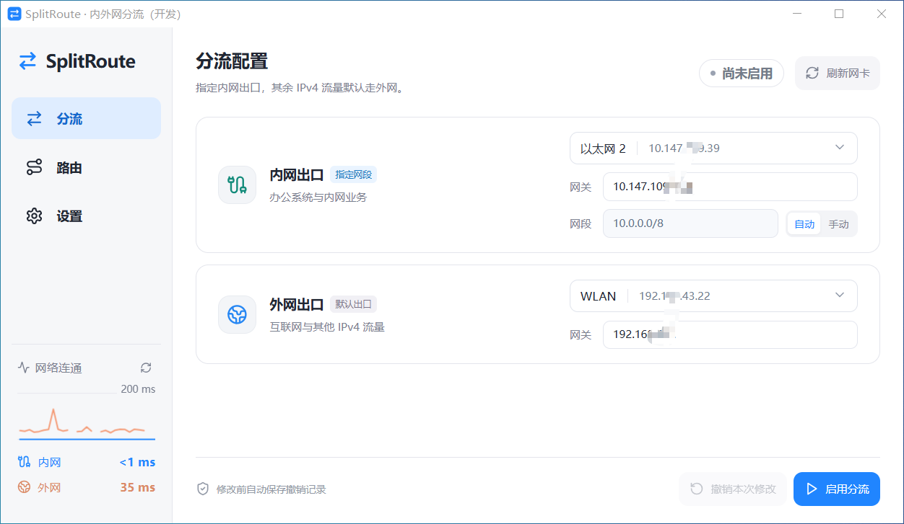
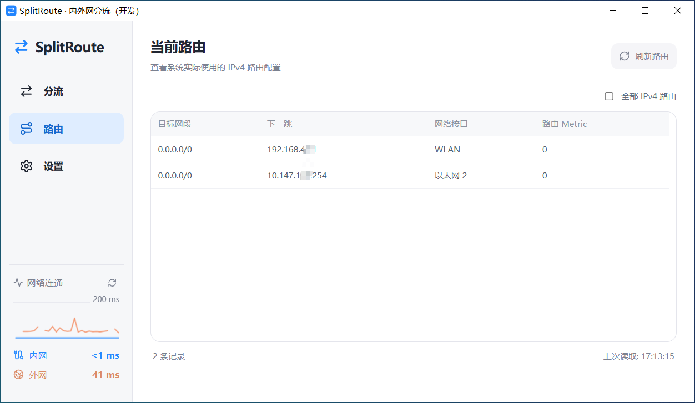
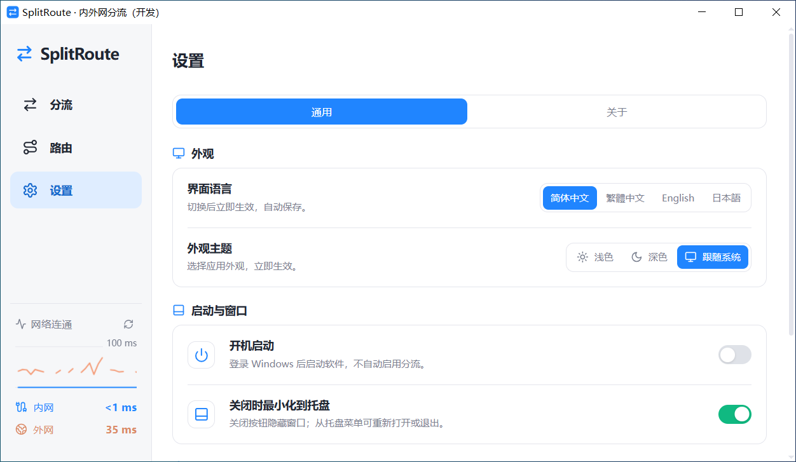
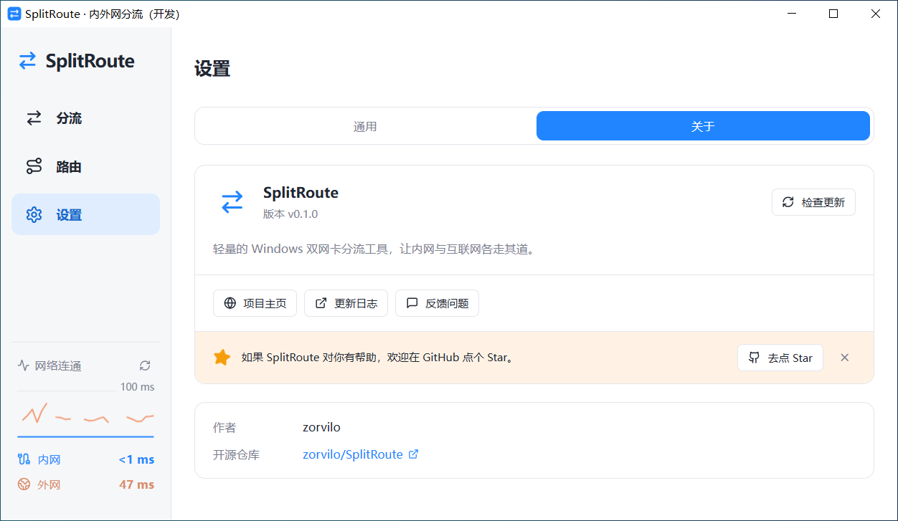

# SplitRoute

轻量级 内外网分流工具，让办公内网与互联网同时可用，有线、Wi-Fi 可自由指定内外网出口。

**简体中文** | [English](README.en.md)

[下载 v1.0.1](https://github.com/zorvilo/SplitRoute/releases/tag/v1.0.1) · [快速开始](#快速开始) · [网络行为](#网络行为) · [反馈问题](https://github.com/zorvilo/SplitRoute/issues)



## 适用场景

电脑同时连接内网与互联网，希望在同一台电脑上访问办公系统和互联网。可自行指定两个网络接口的用途，不限制有线或 Wi-Fi：有线走内网、Wi-Fi 走互联网，或反过来都可以。

SplitRoute 将指定 IPv4 网段交给内网出口，其余 IPv4 流量默认交给外网出口。现有更具体的路由仍然优先。

需要两个可用的网络接口和正确的网关配置。软件不会为原本无法联网的接口提供互联网连接，也不提供代理、VPN、域名或按应用分流。

## 主要功能

- **内外网分流**：选择网卡、确认网关与网段，启用前查看出口摘要。
- **网段自动填入**：按私有 IPv4 范围带出网段，也可手动修改。
- **撤销本次修改**：保存本次变更记录，撤销前检查环境与相关路由。
- **实际路由查看**：切换相关路由与全部 IPv4 路由，显示读取时间。
- **网络变化提醒**：相关接口或路由变化后保留提醒，恢复后自动核对状态；不自动修复路由。
- **内外网连通检测**：通过所选网卡检测延迟，支持自定义 IPv4 目标。
- **桌面设置**：关闭到托盘、可选开机启动、深浅主题及四种界面语言。

## 下载与运行环境

当前版本为 **1.0.1**。前往 [下载页面](https://github.com/zorvilo/SplitRoute/releases/tag/v1.0.1) 获取 Windows x64 安装包或直接运行版，也可按照下方[开发指南](#开发指南)从源码运行。

后续发布可在 [GitHub Releases](https://github.com/zorvilo/SplitRoute/releases) 查看。不要将开发目录中的 EXE 单独复制到其他电脑使用，它依赖本地开发服务。

运行环境：Windows 10/11 与 Microsoft Edge WebView2 Runtime。正式安装包配置为在缺少 WebView2 时联网安装运行时，不内置离线浏览器内核。网络修改需要管理员权限；未签名构建可能出现 Windows 下载信誉提示。

## 快速开始

1. **连接网络**：连接内网和外网接口，在“分流”页分别选择对应网卡。
2. **确认配置**：检查两侧网关，确认需要走内网的目标网段。
3. **启用分流**：点击“启用分流”，核对摘要后确认。普通权限运行时可通过授权弹窗以管理员身份重新启动，重启后需再次确认操作。
4. **查看状态**：在“路由”页检查实际配置。需要撤销时，使用“撤销本次修改”。

### 自动网段规则

| 所选内网 IPv4                | 自动填入         |
| ---------------------------- | ---------------- |
| `10.x.x.x`                   | `10.0.0.0/8`     |
| `172.16.x.x` ～ `172.31.x.x` | `172.16.0.0/12`  |
| `192.168.x.x`                | `192.168.0.0/16` |

自动模式使用所选网卡的首个 IPv4 地址识别上述范围，其他地址需手动填写。这些是完整的私有地址范围，不等于公司业务的实际范围；如果只需访问更小的网段，请切换手动模式填写。

## 界面预览

<details>
<summary>当前路由</summary>

进入页面自动读取，支持相关路由和全部 IPv4 路由筛选。切换或刷新成功时更新表格与读取时间，不重复弹成功通知。



</details>

<details>
<summary>通用设置</summary>

支持简体中文、繁體中文、English、日本語，以及浅色、深色、跟随系统。设置有效后自动保存。

首次点击关闭按钮时，可选择隐藏到托盘或退出程序。勾选“记住我的选择”后，下次会直接执行。可在「设置 → 通用」中更改关闭方式。开机启动默认关闭。



</details>

<details>
<summary>关于</summary>

查看版本、访问项目主页、反馈问题或手动检查更新。检查更新不会自动下载安装，发现新版后提供发布页入口。



</details>

以上为开发版截图，部分地址已遮挡；截图中的网卡、网关和路由是展示环境，不应照抄为自己的配置。通用设置截图未展示下方“连通检测”分组。

## 网络行为

| 问题                       | 行为                                                                                                            |
| -------------------------- | --------------------------------------------------------------------------------------------------------------- |
| 关闭软件会恢复网络吗？     | 不会。已写入的临时路由在退出应用后仍然生效。需要撤销时，请先点击“撤销本次修改”。                                |
| 重启电脑后还生效吗？       | 软件不写入持久路由。重启后由 Windows 和其他网络软件重新建立路由，需重新检查并按需启用；不会自动重放旧撤销记录。 |
| 再次打开如何判断状态？     | 重新读取实际网卡和路由，不仅依赖“曾经启用”的记录。                                                              |
| 撤销会恢复所有网络设置吗？ | 只撤销本次开机中记录的修改，不是全系统网络重置。网卡、IP、网关或相关路由变化时可能停止撤销，避免覆盖其他修改。  |
| 会修改 DNS 或 IPv6 吗？    | 不会。只处理 IPv4 路由。IPv6 流量不受本工具的分流规则控制。                                                     |
| 断网后会自动重新启用吗？   | 不会。应用运行期间检查相关状态，变化后提醒；重连后重新核对，只有匹配时才恢复正常状态。                          |
| 开机启动会自动启用分流吗？ | 不会。仅在登录 Windows 后启动软件。                                                                             |

配置保存在 `%LOCALAPPDATA%/SplitRoute`：`config.json` 为分流配置，`recovery.json` 为撤销记录，`preferences.json` 为偏好设置。需要保留撤销能力时，请勿删除撤销记录。

## 连通检测

侧栏蓝线表示内网延迟，橙线表示外网延迟，单位为 **ms**，不是上传下载速率。

- 内网默认检测所填网关，外网默认检测 `223.5.5.5`。
- 在“设置 → 通用 → 连通检测”可将内网切换为自定义 IPv4，并修改外网目标或恢复默认。
- 使用所选接口的首个 IPv4 作为源地址，并检查实际路由出口；正常情况下每秒采样一次，保留最近 30 次结果。
- 单次 ICMP 超时为 800 ms，请求不重叠；窗口隐藏时暂停定时探测。
- 修改目标后重置历史曲线。无响应显示断线，Windows 返回 0 ms 时显示 `<1 ms`。

Ping 超时也可能是对端限制 ICMP，不等于一定断网；能 Ping 通也不保证 DNS、网页或业务服务可用。

## 常见问题

### 为什么看不到两张网卡？

确认两侧网络已连接并具有 IPv4 地址，再点击“刷新网卡”。启用后接口不可用时会保留原名称和配置，提示检查连接。

### 为什么启用被 VPN 或其他网卡阻止？

当前实现会拒绝存在第三张网卡默认路由的情况，避免改动其他网络出口。请先确认 VPN 或其他接口是否需要继续使用，不要直接删除不认识的路由。

### 为什么网络变化后不能撤销？

撤销会检查本次开机标识、网卡环境与相关路由。环境与记录不匹配时会停止；它不会强行恢复旧网络状态。先查看当前路由和连接情况，再决定如何处理。

### 为什么移动便携 EXE 后开机启动失效？

登录启动使用当前用户的计划任务，记录程序位置。移动后请关闭再重新开启“开机启动”，更新任务路径；该选项不会自动启用分流。

### 为什么直接双击开发版 EXE 无法访问页面？

开发版依赖 `http://127.0.0.1:1420` 的 Vite 服务。请从项目目录执行 `npm run desktop`。正式构建包含界面资源，不依赖该开发服务。

## 开发指南

技术栈：Tauri 2、Rust、Vue 3、TypeScript、Reka UI。

需要 Node.js 22、Rust MSVC 工具链、Visual Studio C++ 构建工具与 WebView2 Runtime。

```powershell
npm ci
npm run desktop
```

开发版默认以普通权限运行，窗口标题带“（开发）”；浏览器预览可执行 `npm run dev`，但不提供真实网络操作。开发与正式实例、普通与管理员实例分别处理单实例标识。

### 检查

```powershell
npm test
npm run format:check
npx vue-tsc --noEmit
cargo fmt --manifest-path src-tauri/Cargo.toml --check
cargo clippy --manifest-path src-tauri/Cargo.toml --all-targets -- -D warnings
cargo test --manifest-path src-tauri/Cargo.toml
```

自动测试不修改真实路由，不注册登录启动任务，也不能替代真实双网卡、IP 改变、撤销、重启、托盘、UAC 和 Windows DPI 验收。布局检查不能替代实际 Windows DPI 验收。

### 构建

需要生成发布产物时执行：

```powershell
npm run tauri -- build
```

- 程序：`src-tauri/target/release/splitroute.exe`
- 安装包：`src-tauri/target/release/bundle/nsis/`
- 正式版启动时请求管理员权限。

### 代码结构

```text
frontend/
  components/          页面组件、确认弹窗与统一通知
  composables/         路由、偏好与连通检测状态及测试
  api.ts               IPC 类型与调用入口
  notifications.ts     通知队列
  i18n.ts              四种界面语言
  subnet.ts            私有网段规则
  App.vue              导航与页面组装
  styles.css           深浅主题和布局
src-tauri/src/
  domain.rs            模型、校验与路由计划
  application.rs       状态判断、启用、撤销与回滚
  commands.rs          路由命令边界
  settings.rs          设置、存储及更新命令
  desktop.rs           托盘与窗口行为
  infrastructure/      Windows 网络、权限、存储、登录启动和更新请求
  main.rs              依赖组装与启动
```

## 反馈问题

欢迎通过 [GitHub Issues](https://github.com/zorvilo/SplitRoute/issues) 反馈问题。请提供软件版本、Windows 版本、操作步骤和错误信息；涉及截图或路由表时，请先遮挡公司地址等不希望公开的信息。

## 许可证

本项目采用 [MIT 许可证](LICENSE)。
